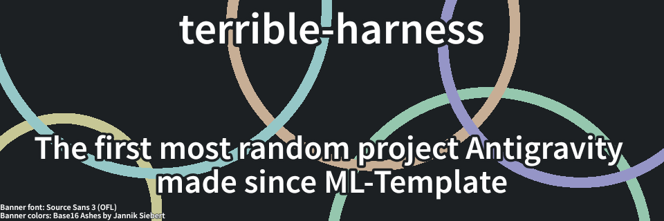

This used to be full. It isn't.

Anyways.

# AskGPT (IT'S CALLED TERRIBLE HARNESS-)

This is a project I made in my freetime before high school started.

TL;DR I was bored as fuck.

## Installation

It's relatively simple.

You just need Node 20 and NPM.

| Version | How-To |
|---|---|
| Git (clone) | Clone, then enter the project directory and `npm i && npx tsup && npm link` |
| Git (ZIP) | Unpack, then follow the steps documented for Git (clone) |
| NPM (Deprecated) | `npm i terrible-harness`. Done. |

## MX

`cat` or `type`. Done.

## Flags?

Figure it out on your own, m8.

## License

This repository is licensed under the [MIT License.](LICENSE)
